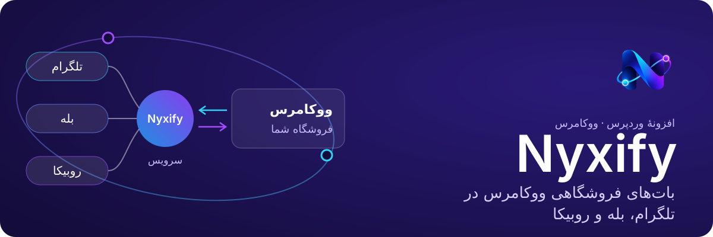
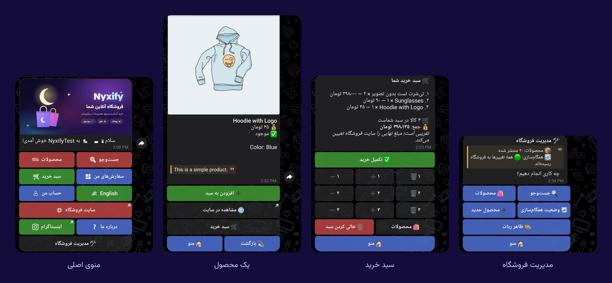
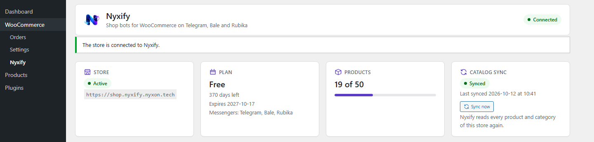
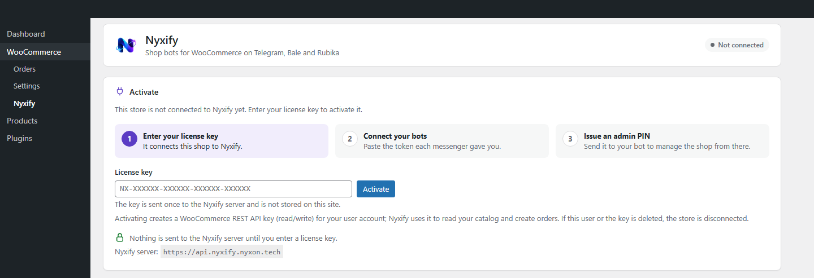
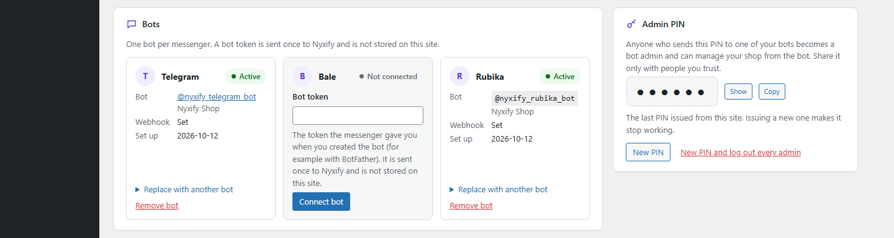
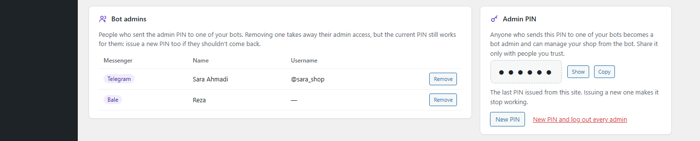
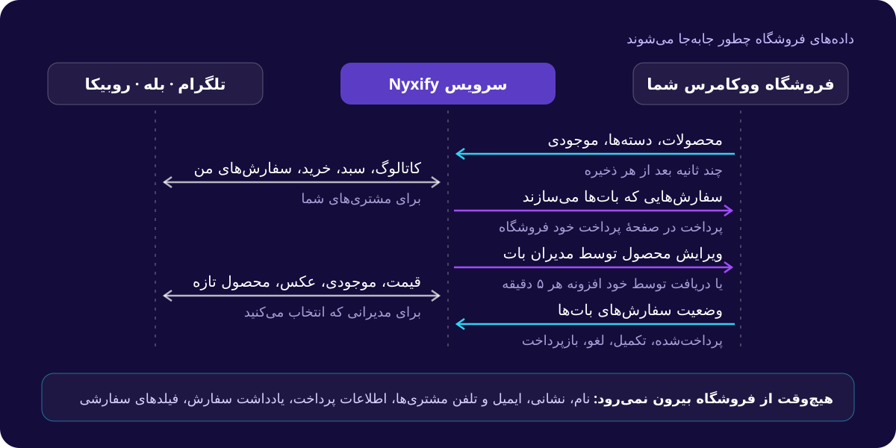

<p align="center">
  
</p>

<p align="center">
  <a href="https://wordpress.org/plugins/nyxify/"></a>
  <a href="https://wordpress.org/plugins/nyxify/"></a>
  
  <a href="LICENSE"></a>
</p>

<p align="center" dir="rtl">
  <a href="https://wordpress.org/plugins/nyxify/"><b>نصب از WordPress.org</b></a> ·
  <a href="https://nyxify.nyxon.tech/fa/">وب‌سایت</a> ·
  <a href="https://wordpress.org/support/plugin/nyxify/">انجمن پشتیبانی</a> ·
  <a href="https://translate.wordpress.org/projects/wp-plugins/nyxify/">ترجمه</a> ·
  <a href="https://nyxify.nyxon.tech/fa/privacy/">حریم خصوصی</a> ·
  <a href="https://nyxify.nyxon.tech/fa/terms/">شرایط استفاده</a>
</p>

<p align="center"><a href="README.md">English</a> · <b>فارسی</b></p>

<div dir="rtl">

**Nyxify فروشگاه ووکامرس شما را به بات‌های فروشگاهی در تلگرام، بله و روبیکا تبدیل می‌کند.** مشتری‌ها دسته‌ها و
محصولات فروشگاه را می‌بینند، سبد خرید را پر می‌کنند و داخل همان پیام‌رسان سفارش می‌دهند؛ سفارش در ووکامرس ثبت
می‌شود و پرداختش در صفحهٔ پرداخت خود فروشگاه انجام می‌شود. کسانی که فروشگاه انتخاب می‌کند هم محصولات را از داخل
بات مدیریت می‌کنند: قیمت، موجودی، توضیحات، عکس و محصول تازه.

بات‌ها روی سرویس Nyxify اجرا می‌شوند، نه روی سرور فروشگاه. این افزونه طرفِ فروشگاه است: فروشگاه را با یک کلید لایسنس
وصل می‌کند، کاتالوگ و سفارش‌های بات‌ها را همگام نگه می‌دارد و یک صفحهٔ تنظیمات برای بات‌ها، مدیرانشان و ظاهرشان
در اختیار فروشگاه می‌گذارد.

## داخل پیام‌رسان

<p align="center">
  
</p>

## در پیشخوان فروشگاه

<p align="center">
  
</p>

<details>
<summary><b>اسکرین‌شات‌های بیشتر</b>: فعال‌سازی، بات‌ها، PIN مدیر</summary>
<br>

**هنوز وصل نشده:** فرم کلید لایسنس.


**بات‌ها:** برای هر پیام‌رسانی که پلن شامل آن است یکی.


**PIN مدیر و مدیران بات:** هر کس PIN را به یکی از بات‌ها بفرستد، می‌تواند فروشگاه را از همان‌جا مدیریت کند.


</details>

## چه کارهایی می‌کند

- **اتصال با کلید لایسنس.** تا وقتی مدیر فروشگاه کلید را در *ووکامرس › Nyxify* وارد نکند، هیچ چیزی به هیچ جا فرستاده
  نمی‌شود. بعد افزونه یک کلید REST API ووکامرس برای سرویس می‌سازد و فروشگاه را وصل می‌کند.
- **راه‌اندازی بات‌ها.** توکنی را که پیام‌رسان داده (مثلاً توکن BotFather در تلگرام) وارد کنید؛ سرویس آن را بررسی و
  بات را راه‌اندازی می‌کند. توکن هیچ‌وقت در فروشگاه ذخیره نمی‌شود.
- **مدیران بات.** با یک PIN مدیر، هر کس آن را به بات بفرستد مدیر می‌شود. مدیران را ببینید و حذف کنید، یا PIN تازه
  بسازید و همه را بیرون کنید.
- **ظاهر بات‌ها.** در *ووکامرس › ظاهر ربات*: منوی اصلی، همهٔ متن‌هایی که بات‌ها می‌فرستند (فارسی و انگلیسی)، پیام و بنر
  خوش‌آمد، آیکون و رنگ دسته‌ها، توضیح بات و اطلاعات تماس فروشگاه.
- **کاتالوگ همیشه همگام.** هر تغییر در محصول، متغیر، موجودی یا دسته در پس‌زمینه و در چند ثانیه به سرویس می‌رسد.
  ذخیرهٔ محصول هیچ‌وقت منتظر سرویس نمی‌ماند.
- **پشت هاست‌های سخت‌گیر هم کار می‌کند.** اگر سرویس به فروشگاه دسترسی نداشته باشد، خود افزونه هر ۵ دقیقه ویرایش‌های
  مدیران بات را می‌گیرد و از طریق REST API خود ووکامرس اعمال می‌کند.
- **رفتنِ تمیز.** غیرفعال کردن، بات‌ها را متوقف و اتصال و کلید REST API آن را حذف می‌کند؛ حذف افزونه تنظیمات و
  داده‌های خودش را پاک می‌کند. محصولات و سفارش‌ها می‌مانند.

## چطور کار می‌کند

<p align="center">
  
</p>

فقط سفارش‌هایی که سرویس از طریق بات ساخته فرستاده می‌شوند، و از آن‌ها فقط شناسه، وضعیت، شماره، واحد پول، مبلغ،
تاریخ‌ها و اقلام. نام، نشانی، ایمیل، شمارهٔ تلفن، اطلاعات پرداخت، یادداشت‌ها و فیلدهای سفارشی مشتری‌ها حتی خوانده هم
نمی‌شوند. همهٔ درخواست‌ها امضا می‌شوند (HMAC-SHA256) و رازها رمزنگاری‌شده نگه داشته می‌شوند. جزئیات:
[چطور کار می‌کند](docs/how-it-works.md) (انگلیسی) و [سیاست حریم خصوصی](https://nyxify.nyxon.tech/fa/privacy/).

## شروع

1. **ووکامرس** ۹٫۰ یا بالاتر را نصب و فعال کنید.
2. **Nyxify** را از *افزونه‌ها › افزودن* (جست‌وجوی «Nyxify») یا از
   [WordPress.org](https://wordpress.org/plugins/nyxify/) نصب و فعال کنید. با WP-CLI:

   ```bash
   wp plugin install nyxify --activate
   ```

3. در **ووکامرس › Nyxify** کلید لایسنس را وارد کنید و *فعال‌سازی* را بزنید.
4. برای هر پیام‌رسانی که پلن شما شامل آن است، با توکنی که پیام‌رسان داده یک بات اضافه کنید.
5. یک PIN مدیر بسازید و به بات بفرستید تا مدیرش شوید.

| پیش‌نیاز | نسخه |
|---|---|
| وردپرس | ۶٫۵ یا بالاتر |
| ووکامرس | ۹٫۰ یا بالاتر |
| PHP | ۸٫۱ یا بالاتر، با `sodium` (همراه PHP هست) |
| فروشگاه | از اینترنت با HTTPS در دسترس، REST API آن (`/wp-json/`) بدون ریدایرکت پاسخ بدهد، WP-Cron اجرا شود |

کلید لایسنس را سرویس Nyxify می‌دهد: [nyxify.nyxon.tech](https://nyxify.nyxon.tech/fa/) ·
[nyxify@nyxon.tech](mailto:nyxify@nyxon.tech)

## توسعه

```bash
composer install
composer check    # PHPCS (WordPress Coding Standards), PHPStan level 8, PHPUnit
composer build    # dist/nyxify-<version>.zip, the same zip WordPress.org gets
```

دستورها، ساختار کد و قواعد آن: [توسعه](docs/development.md) (انگلیسی).

## امنیت

مشکلات امنیتی را لطفاً به‌صورت خصوصی به [nyxify@nyxon.tech](mailto:nyxify@nyxon.tech) گزارش کنید، نه در یک issue
عمومی. [SECURITY.md](SECURITY.md) را ببینید.

## مجوز

[GPL-2.0-or-later](LICENSE). فونت [وزیرمتن](https://github.com/rastikerdar/vazirmatn) با مجوز SIL Open Font License 1.1
همراه افزونه است ([`assets/fonts/vazirmatn/OFL.txt`](assets/fonts/vazirmatn/OFL.txt)).

</div>
