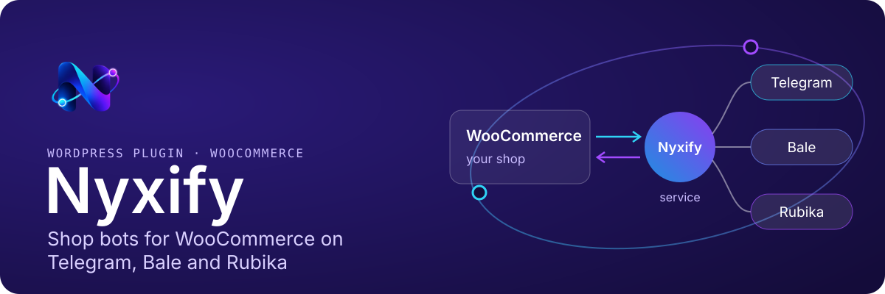
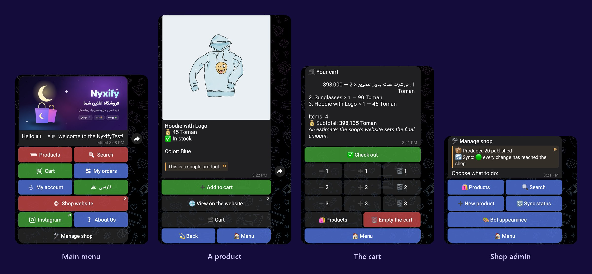
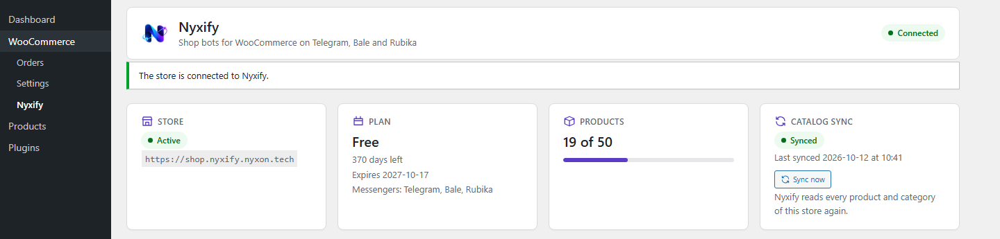
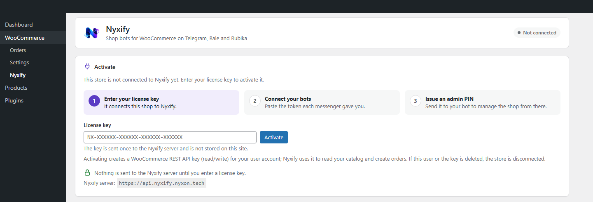
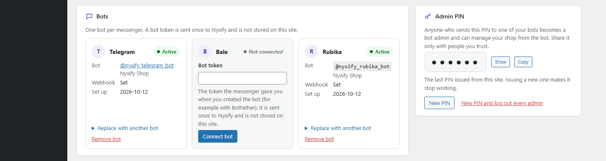
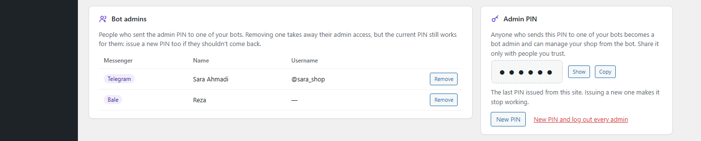
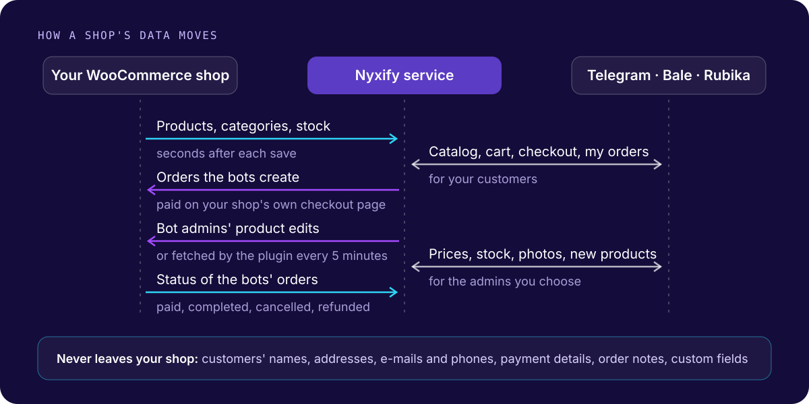

<p align="center">
  
</p>

<p align="center">
  <a href="https://wordpress.org/plugins/nyxify/"></a>
  <a href="https://wordpress.org/plugins/nyxify/"></a>
  
  <a href="LICENSE"></a>
</p>

<p align="center">
  <a href="https://wordpress.org/plugins/nyxify/"><b>Install from WordPress.org</b></a> ·
  <a href="https://nyxify.nyxon.tech/">Website</a> ·
  <a href="https://wordpress.org/support/plugin/nyxify/">Support forum</a> ·
  <a href="https://translate.wordpress.org/projects/wp-plugins/nyxify/">Translate</a> ·
  <a href="https://nyxify.nyxon.tech/privacy/">Privacy</a> ·
  <a href="https://nyxify.nyxon.tech/terms/">Terms</a>
</p>

<p align="center"><b>English</b> · <a href="README.fa.md">فارسی</a></p>

**Nyxify turns a WooCommerce shop into shop bots on Telegram, Bale and Rubika.** Customers browse the shop's
categories and products, fill a cart and check out inside the messenger; the order is created in WooCommerce and paid
on the shop's own checkout page. The people the shop chooses manage products from the bot too: prices, stock,
descriptions, photos, new products.

The bots run on the Nyxify service, not on the shop's server. This plugin is the shop's side of it: it connects the
shop with a license key, keeps the catalog and the bots' orders in step, and gives the shop a settings page for its
bots, their admins and their look.

## In the messenger

<p align="center">
  
</p>

## On the shop's dashboard

<p align="center">
  
</p>

<details>
<summary><b>More screenshots</b>: activation, bots, admin PIN</summary>
<br>

**Not connected yet:** the license key form.


**Bots:** one per messenger the plan includes.


**Admin PIN and bot admins:** whoever sends the PIN to a bot can manage the shop from it.


</details>

## What it does

- **Connects with a license key.** Nothing is sent anywhere before the shop's administrator enters it on
  *WooCommerce › Nyxify*. The plugin then creates a WooCommerce REST API key for the service and connects the shop.
- **Sets up the bots.** Paste the token a messenger gave you (BotFather's on Telegram, for example); the service
  checks it and sets the bot up. The token is never stored on the shop.
- **Bot admins.** An admin PIN turns whoever sends it to a bot into an admin. See and remove admins, or issue a new
  PIN and log everyone out.
- **The bots' look.** On *WooCommerce › Bot appearance*: the main menu, every text the bots send (Persian and
  English), the welcome message and banner, category icons and colors, the bot's description and the shop's contact
  details.
- **Keeps the catalog in step.** Every change to a product, a variation, its stock or a category reaches the service
  in the background within seconds. Saving a product never waits for it.
- **Works behind strict hosts.** When the service can't reach the shop, the plugin fetches the bot admins' edits
  itself every 5 minutes and applies them through WooCommerce's own REST API.
- **Leaves cleanly.** Deactivating stops the bots and removes the connection and its REST API key; deleting removes
  the plugin's settings and data. Products and orders stay.

## How it works

<p align="center">
  
</p>

Only orders the service created through a bot are ever sent back, and only their id, status, number, currency,
total, dates and line items. Customers' names, addresses, e-mails, phone numbers, payment details, notes and custom
fields are never even read. Every request is signed (HMAC-SHA256) and secrets are kept encrypted. The details:
[How it works](docs/how-it-works.md) and the [Privacy Policy](https://nyxify.nyxon.tech/privacy/).

## Get started

1. Install and activate **WooCommerce** 9.0 or later.
2. Install **Nyxify** from *Plugins › Add New* (search for "Nyxify") or from
   [WordPress.org](https://wordpress.org/plugins/nyxify/), and activate it. With WP-CLI:

   ```bash
   wp plugin install nyxify --activate
   ```

3. On **WooCommerce › Nyxify**, enter your license key and click *Activate*.
4. Add a bot for each messenger your plan includes, using the token the messenger gave you.
5. Issue an admin PIN and send it to your bot to become its admin.

| Requirement | Version |
|---|---|
| WordPress | 6.5 or later |
| WooCommerce | 9.0 or later |
| PHP | 8.1 or later, with `sodium` (bundled with PHP) |
| The shop | reachable over HTTPS, its REST API (`/wp-json/`) answering without a redirect, WP-Cron running |

A license key comes from the Nyxify service: [nyxify.nyxon.tech](https://nyxify.nyxon.tech/) ·
[nyxify@nyxon.tech](mailto:nyxify@nyxon.tech).

## Development

```bash
composer install
composer check    # PHPCS (WordPress Coding Standards), PHPStan level 8, PHPUnit
composer build    # dist/nyxify-<version>.zip, the same zip WordPress.org gets
```

Commands, the code's layout and its rules: [Development](docs/development.md).

## Security

Please report security issues privately to [nyxify@nyxon.tech](mailto:nyxify@nyxon.tech), not in a public issue.
See [SECURITY.md](SECURITY.md).

## License

[GPL-2.0-or-later](LICENSE). Bundles the [Vazirmatn](https://github.com/rastikerdar/vazirmatn) font under the
SIL Open Font License 1.1 ([`assets/fonts/vazirmatn/OFL.txt`](assets/fonts/vazirmatn/OFL.txt)).
